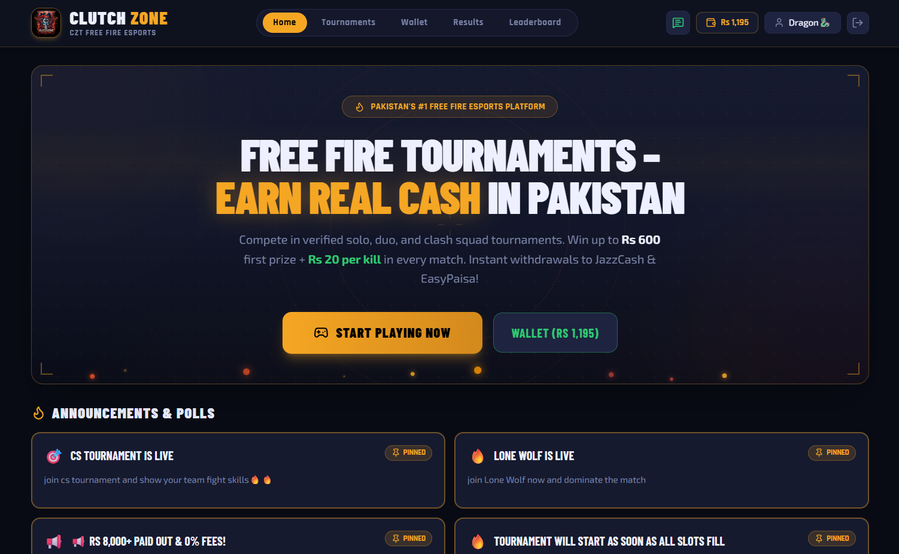
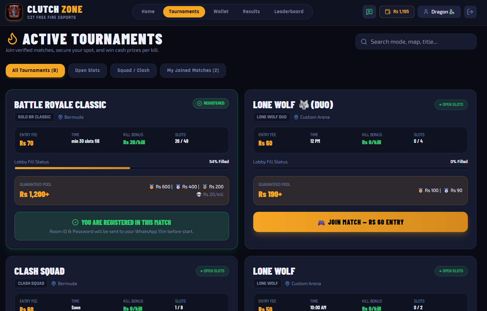
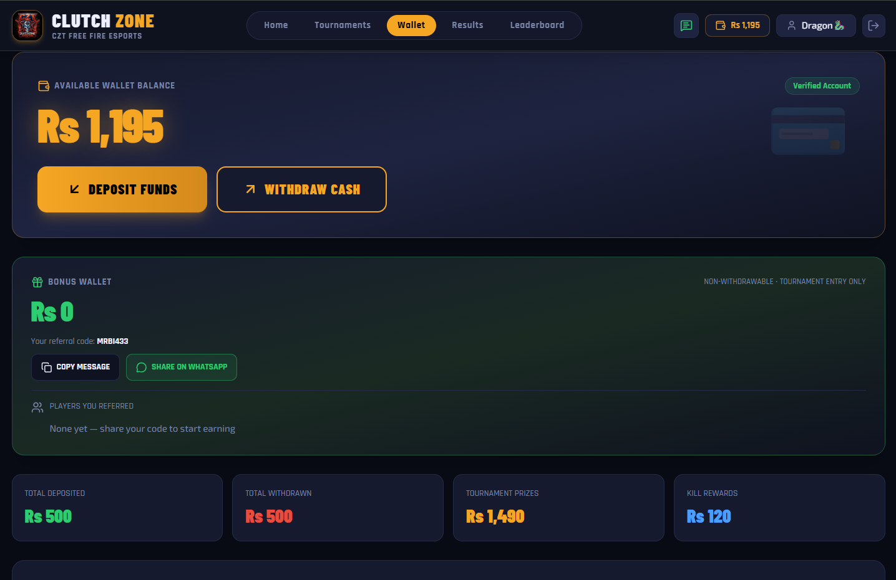
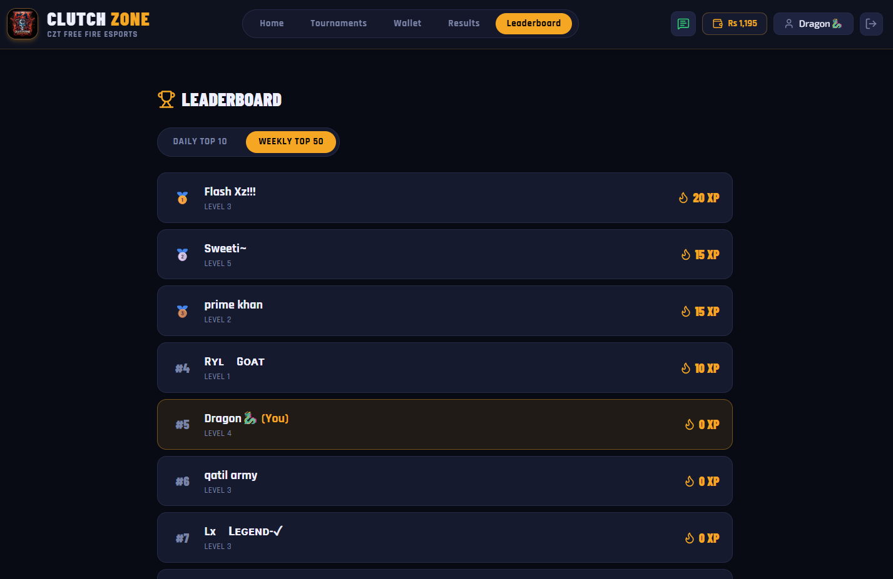
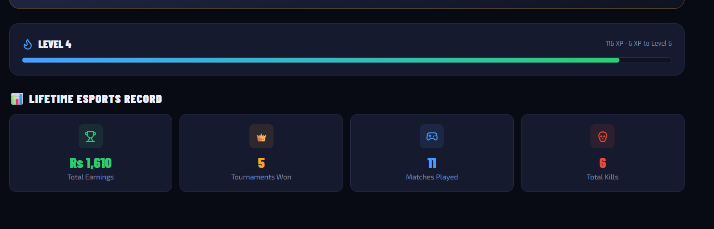

# ClutchZone: Free Fire Esports Tournament Platform

A real-money Free Fire tournament platform built for players across Pakistan. Players sign in, join matches with a wallet balance, receive room details on WhatsApp, climb a leaderboard, and withdraw winnings to JazzCash, EasyPaisa or a bank account.

**Live site:** [clutchzone.fun](https://clutchzone.fun)
**Status:** In production with 500+ registered players and Rs 11,000+ distributed in prizes and rewards.

> This repository is a sanitized copy of the production frontend. Payment numbers, contact details and the admin panel are not included. See [Configuration](#configuration).

## Screenshots

| Home | Tournaments |
|------|-------------|
|  |  |

| Wallet | Leaderboard |
|--------|-------------|
|  |  |



## Features

**Tournaments**
- Multiple formats: Battle Royale (Classic and Lite), Clash Squad, Lone Wolf (solo and duo)
- Live slot counter and lobby fill status on every match card
- Guaranteed prize pool per placement, plus optional per-kill bonus
- One-tap join using wallet balance, with clear states (open slots, registered, lobby full)
- Search and filters: open slots, squad/clash, my joined matches

**Wallet**
- Deposit and withdrawal requests with transaction history and filters
- Separate bonus wallet (non-withdrawable, tournament entry only)
- Referral code with WhatsApp sharing
- Totals for deposited, withdrawn, tournament prizes and kill rewards

**Players**
- Google sign-in and profile setup (Free Fire UID, payout method)
- XP and level system with progress bar
- Lifetime record: earnings, tournaments won, matches played, kills
- Daily Top 10 and Weekly Top 50 leaderboards

**Platform**
- Room ID and password delivered to players on WhatsApp 15 minutes before a match
- Pinned announcements and polls
- Match results tab
- Push notifications (Firebase Cloud Messaging)
- Installable PWA with mobile-first layout

## Tech Stack

- **Frontend:** React, TypeScript, Vite
- **Backend services:** Firebase (Authentication, Firestore, Cloud Messaging)
- **Hosting:** Vercel
- **Development approach:** AI-assisted (Claude, Google AI Studio), with manual review, debugging and production operations by me

## Getting Started

```bash
git clone https://github.com/Bilal-Sardar/clutchzone-platform.git
cd clutchzone-platform
npm install
cp .env.example .env     # on Windows: copy .env.example .env
npm run dev
```

## Configuration

Copy `.env.example` to `.env` and fill in your own values:

| Variable | Purpose |
|----------|---------|
| `VITE_OWNER_WHATSAPP` | WhatsApp number (with country code) used for support and deposit messages |
| `VITE_OWNER_EMAIL` | Owner contact email |
| `VITE_AGENT_NUMBER` | Mobile wallet number shown on the deposit screen |
| `VITE_AGENT_TITLE` | Account title shown on the deposit screen |

You also need your own Firebase project (Authentication, Firestore and Cloud Messaging enabled) and matching Firestore security rules.

## Project Structure

```
src/
  components/        Tabs (Home, Tournaments, Wallet, Results, Leaderboard, Profile) and modals
  context/           Auth and app state (AuthContext)
  firebase.ts        Firebase setup and config constants
  leaderboard.ts     XP and ranking logic
  types.ts           Shared TypeScript types
public/              PWA manifest, icons, service worker
```

## Notes

- The admin panel is a separate private project and is not part of this repository. It is used to run the platform day to day:
  - Player database and wallet balance management
  - Tournament creation, slot and prize setup, and prize distribution
  - Withdrawal approvals and match results
  - Announcements, polls and push broadcasts (FCM)
  - Referral network overview and WhatsApp automation
  - Audit log of every admin action
- Firebase web API keys are public by design. Data access is protected by Firestore security rules.

## Author

**Bilal Sardar**: [Portfolio](https://bilal-sardarportfolio.vercel.app) | [GitHub](https://github.com/Bilal-Sardar)
